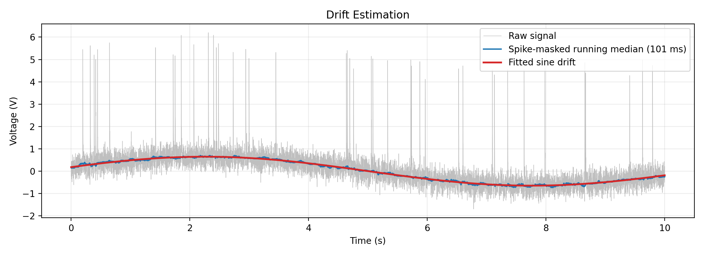
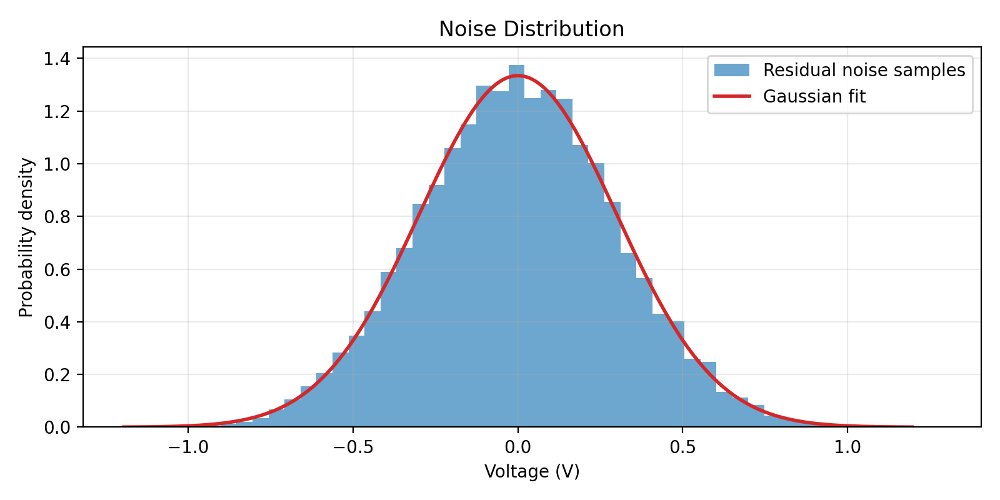
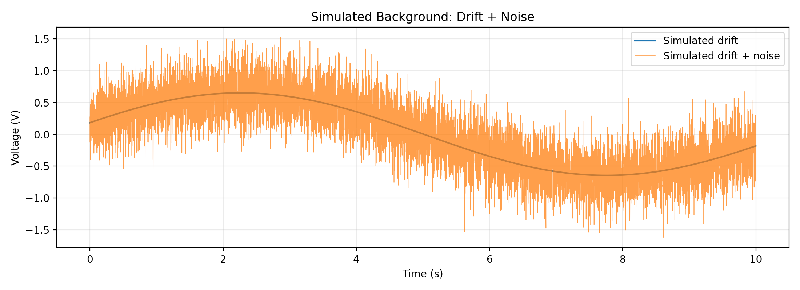

# Drift & Noise: Modeling and Simulation

**Author:** Gloria Wu

## Model

The background voltage is modeled as the sum of two components:

`background(t) = drift(t) + noise(t)`

- **Drift:** A slowly varying baseline modeled by a sine function.
- **Noise:** Random background fluctuations modeled by a Gaussian distribution.

### Parameter Estimation

A **running median (101 samples)** was first used to estimate the baseline. It calculates the median voltage within a moving window, reducing the influence of large spikes.

After detecting and excluding spike regions, a sine function was fitted to the remaining data to estimate the drift parameters. The fitted drift was then subtracted, and the remaining spike-free samples were used to estimate the noise standard deviation.

### Parameters from Original Data

| Parameter | Value | Source |
|---|---:|---|
| Drift offset (B) | 0.0032 V | Estimated from data |
| Drift amplitude (A) | 0.6475 V | Estimated from data |
| Drift frequency (f) | 0.0909 Hz | Estimated from data |
| Drift phase (φ) | 0.2826 rad | Estimated from data |
| Noise mean (μ) | 0 V | Assumed for simulation |
| Noise SD (σ) | 0.2990 V | Estimated from data |

The sine function and Gaussian distribution were chosen as simplified models. The estimated parameters are saved in `drift_noise_params.json`.

## 1. Drift Estimation

A sine function was fitted to the original recording after excluding spike regions.

`D(t) = B + A sin(2πft + φ)`



The fitted sine wave was used to estimate the drift parameters.

## 2. Noise Estimation

After removing the fitted drift and excluding spike regions, the remaining residuals were used to estimate the noise standard deviation.



The estimated noise standard deviation was 0.2990 V. Gaussian noise with zero mean was assumed for simulation.

## 3. Background Simulation

The estimated parameters were used to generate a new background signal.

`background(t) = D(t) + N(t)`



The simulated background combines the fitted sinusoidal drift model with newly generated Gaussian noise.

## Files

| File | Description |
|---|---|
| `drift_noise.py` | Functions for drift and noise estimation and generation |
| `run_analysis.py` | Runs the analysis and saves results |
| `drift_noise_params.json` | Estimated parameters |
| `figures/` | Figures for drift, noise, and simulation |

Run from the repository root:

```bash
python -m drift_noise.run_analysis
```

## Use in Full Simulation

```python
import json
from drift_noise.drift_noise import generate

with open("drift_noise/drift_noise_params.json") as f:
    p = json.load(f)

drift, noise = generate(t, p, seed=42)

raw = drift + noise + spike_signal
```

## Limitations

- The drift is approximated by a sine function.
- The noise is assumed to be independent Gaussian noise.
- The model reproduces background signal characteristics but does not include spike generation.
