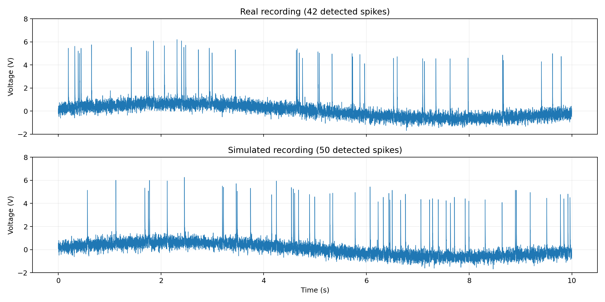
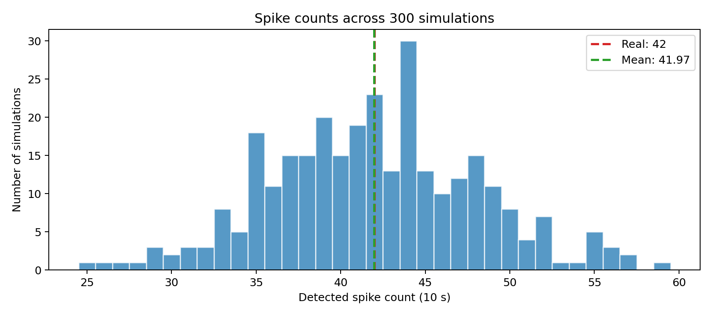

# Full Spike Recording Simulation and Validation

**Team integration:** drift + noise module and Mariya Zastenskaya's spike module.

## Model

The generated recording is the sum of three components:

`V(t) = D(t) + N(t) + S(t)`

- **Drift:** a sinusoidal baseline, `D(t) = B + A sin(2πft + φ)`.
- **Noise:** independent Gaussian samples, `N(t) ~ Normal(0, σ²)`.
- **Spikes:** fixed-amplitude exponential waveforms occurring at random times with refractory lockout. Their inter-spike intervals are drawn from a shifted exponential distribution.

Parameters are loaded from existing `drift_noise/drift_noise_params.json` and `spikes/spike_params.json`. The original data are in `data/spike_data.npz`.

## Run from the repository root

```bash
python -m pip install numpy scipy matplotlib
python -m full_simulation.run_simulation
python -m unittest full_simulation.test_integration
```

This uses the **team's existing modules**. Do not overwrite `spikes/spikes.py` or `drift_noise/drift_noise.py` when adding this directory to an existing repository. The spike generator must expose `generate(n, fs, rate_hz, amplitude, tau_ms, refractory_ms, rng=...)`.

## Parameters

| Component | Parameter | Value |
|---|---|---:|
| Drift | offset | 0.00317 V |
| Drift | amplitude | 0.64754 V |
| Drift | frequency | 0.09089 Hz |
| Drift | phase | 0.28261 rad |
| Noise | standard deviation | 0.29895 V |
| Spike | mean amplitude | 5.016 V |
| Spike | decay time | 2.981 ms |
| Spike | firing rate | 4.2 Hz |
| Spike | refractory period | 2 ms |

## One Simulation: Original vs. Simulated



The first complete simulated 10-second trace uses seed 42 for spike timing and a separate deterministic seed for Gaussian noise.

## Testing: 300 Simulations



| Metric | Original | First simulation | Mean of 300 | Empirical 95% range |
|---|---:|---:|---:|---:|
| Detected spikes | 42 | 50 | 41.97 | 30–55 |
| Firing rate (Hz) | 4.20 | 5.00 | 4.20 | 3.00–5.50 |
| Mean spike peak above drift (V) | 5.03 | 5.02 | 5.05 | 4.95–5.19 |
| Median ISI (ms) | 169 | 153 | 166.53 | 106.48–261.44 |
| Estimated noise SD (V) | 0.299 | 0.300 | 0.300 | 0.295–0.306 |
| Signal minimum (V) | −1.691 | −1.689 | −1.635 | −1.828 to −1.485 |
| Signal maximum (V) | 6.202 | 6.264 | 6.453 | 5.844–8.011 |

The same team spike detector is applied to real and simulated traces. Matching detected peaks to their known simulated positions within 2 ms produced average precision around 1.00 and recall around 0.989. These are **simulation-specific** metrics; true spike times are not known for the original recording.

### Outputs

| File | Description |
|---|---|
| `simulated_spike_data.npz` | One complete simulated 10-second recording, with `t` and `raw_data` |
| `simulation_results.csv` | Individual metrics for all 300 simulated recordings |
| `summary.json` | Single-run values, 300-run means, and empirical 95% ranges |
| `figures/real_vs_simulated.png` | Aligned original and simulated voltage plots |
| `figures/spike_count_distribution.png` | Spike counts from repeated simulation |
| `test_integration.py` | Basic reproducibility and interface tests |

## Limitations

- The parameters were estimated using the original recording, so this is a model check, not independent held-out validation.
- Spike counts vary between runs. One run matching exactly 42 spikes is not required.
- This timing model does not include self-excitation. It may not capture short-time clustering.
- Close spikes can overlap and produce occasional larger peaks than the original data.
- The empirical 95% ranges describe simulation variability; they are not parameter confidence intervals.
