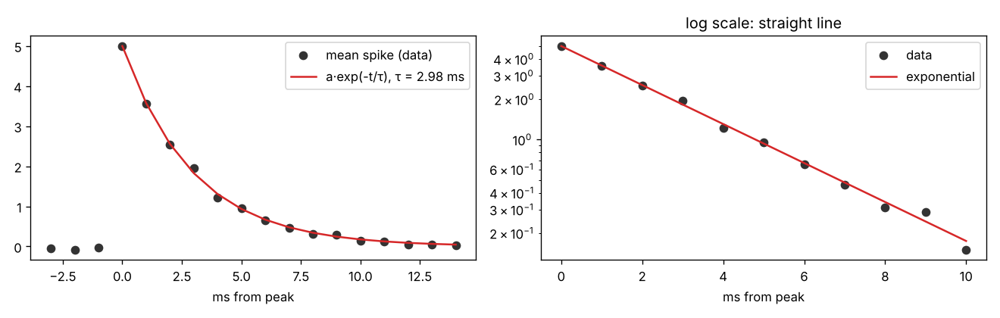
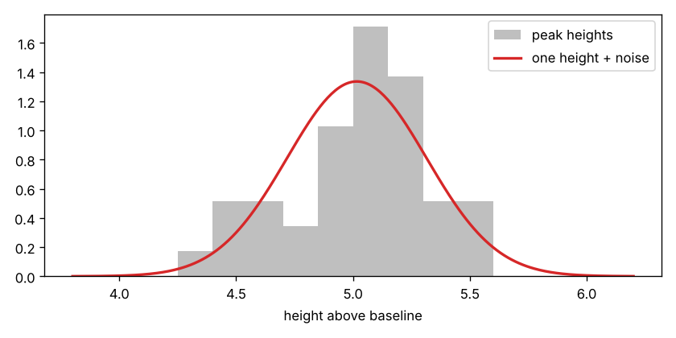
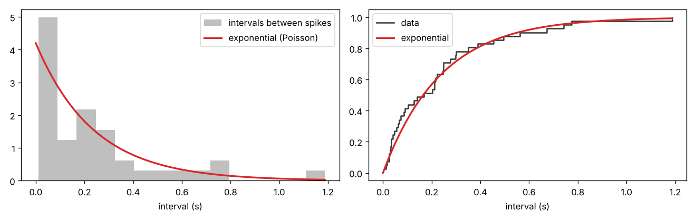
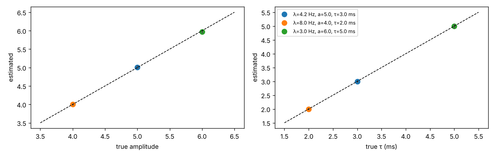

# Spikes: shape, amplitude, timing

Author: Mariya Zastenskaya

## Model

Every spike jumps up within one sample and then decays exponentially:

$$\text{spikes}(t) = \sum_k a \, e^{-(t - t_k)/\tau}, \quad t \ge t_k$$

* **shape:** exponential decay with time constant $\tau$
* **amplitude:** the same height $a$ for every spike
* **timing:** spike times $t_k$ come from a Poisson process with rate $\lambda$

| Parameter | Value | From data or assumed |
|---|---|---|
| decay time constant τ | 2.98 ± 0.04 ms | data |
| amplitude a | 5.02, the same for all spikes | data |
| rate λ | 4.2 Hz (95% CI 3.0–5.7 Hz) | data |
| refractory period | 2 ms | assumption |

The values are saved in `spike_params.json` for the rest of the team.

## Files

| File | What it does |
|---|---|
| `spikes.py` | all functions: load data, baseline, spike detection, estimation, spike generation |
| `run_analysis.py` | runs the whole analysis, prints the results, saves the figures and `spike_params.json` |
| `figures/` | the figures shown below |
| `spike_params.json` | the estimated spike parameters |

Run it from this folder:
```
python run_analysis.py
```

Use the spikes in the full simulation:
```python
import json
from spikes import generate

p = json.load(open("spike_params.json"))
spike_signal, spike_idx = generate(n_samples, fs, p["rate_hz"], p["amplitude"], p["tau_ms"], p["refractory_ms"])
raw = drift + noise + spike_signal
```

## How the spikes are found

1. **Baseline.** A running median over 101 ms follows the slow drift.
2. **Detection.** This is the detector from Assignment 2B. A spike starts where the signal crosses
   baseline + 3 upwards. For the next 5 ms (the dead time) no new spike is counted. The spike time is the
   highest sample in that window.
3. **Second baseline.** The spikes pull the running median up a little, which would make every amplitude
   too small. So the median is computed again with the spike samples left out.

Result: 42 spikes in 10 s.

## 1. Shape

The formula $a\,e^{-t/\tau}$ comes from a simple model of the cell membrane as an RC circuit: after a sudden
jump, the voltage relaxes back exponentially with time constant $\tau = RC$. $\tau$ is the time it takes the spike
to fall to $1/e \approx 37\%$ of its peak. Every 1 ms sample is about 0.72 times the previous one.

We average all isolated spikes, aligned on the peak, and fit $a\,e^{-t/\tau}$ to the average.
A spike counts as isolated when there is no other spike close before or after it, so that no tail of a
neighbour gets mixed in.



* τ = 2.98 ± 0.04 ms, from 37 isolated spikes.
* The samples before the peak are about 0, so the spike rises within one sample.
* On a log scale the decay is a straight line, which means it really is exponential.

## 2. Amplitude

In Assignment 2A the peak heights ranged from about 4.4 to 5.5. Is that a real difference between spikes,
or just the noise on top of each peak?

If all spikes had the same height, the SD of the peaks would equal the noise SD. We check this with a
χ² variance test.



* SD of the peaks: 0.292. Noise SD: 0.299. Test p = 0.55.
* So the spread is explained by the noise alone: **every spike has the same height, a ≈ 5.0.**

## 3. Timing

For a Poisson process:
* the intervals between spikes are exponential (KS test),
* their coefficient of variation is about 1,
* the spike count per second varies like a Poisson count (Fano factor about 1).



| Check | Result | Poisson expects |
|---|---|---|
| KS test, intervals vs exponential | p = 0.76 | p > 0.05 |
| CV of the intervals | 1.09 | 1 |
| Fano factor | 1.26 | 1 |

* **From the data:** λ = 4.2 Hz. With only 42 spikes the 95% interval is wide: 3.0–5.7 Hz.
* **Assumption:** a refractory period of 2 ms. The data cannot measure it. They only show it is shorter than
  11 ms, the shortest interval. 2 ms is the usual value for a neuron.

## 4. Parameter recovery

Does the estimation actually work? We build synthetic recordings where we **know** the true values:
real baseline + spikes from `generate` + Gaussian noise. Then we estimate the parameters again.
We repeat this 50 times for each of three parameter sets.



| True λ, a, τ | Spikes found | Estimated a | Estimated τ (ms) |
|---|---|---|---|
| 4.2 Hz, 5.0, 3.0 ms | 98.9 % | 5.009 ± 0.048 | 2.998 ± 0.044 |
| 8.0 Hz, 4.0, 2.0 ms | 98.0 % | 3.999 ± 0.029 | 1.999 ± 0.036 |
| 3.0 Hz, 6.0, 5.0 ms | 99.6 % | 5.974 ± 0.047 | 4.996 ± 0.085 |

* Amplitude and τ come back within about 0.5 % of the true values.
* The detector misses 1–2 % of the spikes. When two spikes are closer than the 5 ms dead time, they count as one,
  so at high rates the rate comes out slightly low. In the real data this does not happen: the shortest interval
  is 11 ms.
* **What the check caught.** In the first version, the "same height" test gave false alarms in 30–45 % of the
  synthetic recordings. Some peaks included the tail of the previous spike, or two merged spikes. Since then,
  amplitude and shape use isolated spikes only.

