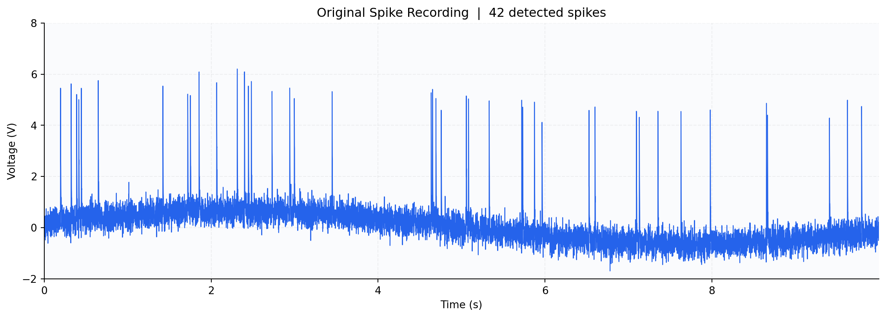
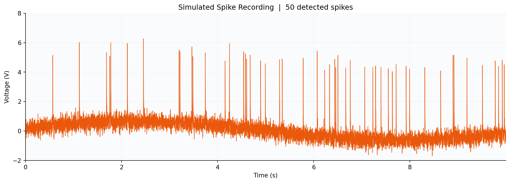
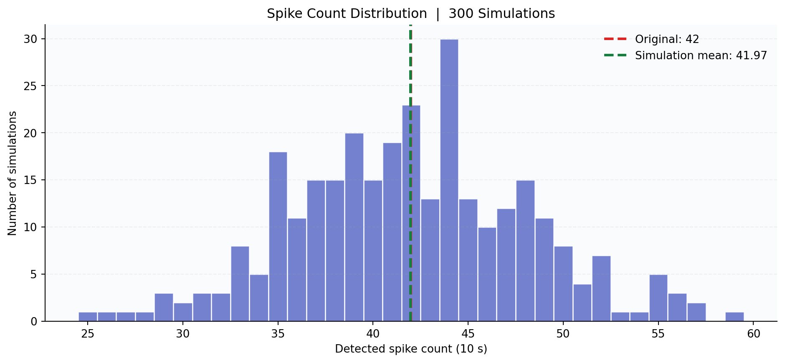

# Full Spike Recording Simulation and Validation

## Model

The simulated extracellular voltage is the sum of three components:

`V(t) = D(t) + N(t) + S(t)`

- **Drift:** sinusoidal baseline, `D(t) = B + A sin(2πft + φ)`.
- **Noise:** independent Gaussian background noise, `N(t) ~ Normal(0, σ²)`.
- **Spikes:** fixed-amplitude, exponentially decaying waveforms with random spike times and a refractory period.

The model reads `drift_noise/drift_noise_params.json` and `spikes/spike_params.json`, estimated from the original `data/spike_data.npz` recording.

## Parameters

| Component | Parameter | Value |
|---|---|---:|
| Drift | Offset | 0.00317 V |
| Drift | Amplitude | 0.64754 V |
| Drift | Frequency | 0.09089 Hz |
| Drift | Phase | 0.28261 rad |
| Noise | Standard deviation | 0.29895 V |
| Spikes | Amplitude | 5.016 V |
| Spikes | Decay time constant | 2.981 ms |
| Spikes | Firing rate | 4.2 Hz |
| Spikes | Refractory period | 2 ms |

## Run from the Repository Root

```bash
python -m pip install numpy scipy matplotlib
python testing/run_simulation.py
python -m unittest testing.test_integration
```

The script creates one simulated 10-second trace (seed 42), evaluates 300 simulations, and regenerates all figures and output files. Run it from the project root, with both team modules and the original data available. The spike module must support `generate(n, fs, rate_hz, amplitude, tau_ms, refractory_ms, rng=...)`.

## 1. Original Recording

The original recording contains 10 seconds of electrode voltage sampled at 1 kHz (10,000 samples). It contains slow baseline drift, background noise, and positive spikes.



## 2. Simulated Recording

The model generates the same-length trace with sinusoidal drift, Gaussian noise and randomly timed, exponentially decaying spikes.



### Original vs. Single Simulation

| Metric | Original | First simulation |
|---|---:|---:|
| Detected spikes | 42 | 50 |
| Firing rate (Hz) | 4.20 | 5.00 |
| Mean spike peak above drift (V) | 5.03 | 5.02 |
| Median ISI (ms) | 169 | 153 |
| Estimated noise SD (V) | 0.299 | 0.300 |
| Signal minimum (V) | -1.691 | -1.689 |
| Signal maximum (V) | 6.202 | 6.264 |

The spike count need not equal 42 in an individual run because spike timing is random.

## 3. Testing Across 300 Simulations

The full simulation was repeated 300 times using different random seeds to examine the statistical variability of the model.



| Metric | Original | Mean of 300 | Empirical 95% range |
|---|---:|---:|---:|
| Detected spikes | 42 | 41.97 | 30–55 |
| Firing rate (Hz) | 4.20 | 4.20 | 3.00–5.50 |
| Mean spike peak above drift (V) | 5.03 | 5.05 | 4.95–5.19 |
| Median ISI (ms) | 169 | 166.53 | 106.48–261.44 |
| Estimated noise SD (V) | 0.299 | 0.300 | 0.295–0.306 |
| Signal minimum (V) | -1.691 | -1.635 | -1.828 to -1.485 |
| Signal maximum (V) | 6.202 | 6.453 | 5.844–8.011 |

The observed 42 spikes lie within the distribution of simulated spike counts. These intervals describe model-generated variability, not confidence intervals for the model parameters.

## 4. Spike Detector Recovery

For simulated data, the generator's known spike times were matched with the detected peaks using a 2 ms tolerance:

- **Mean precision:** about 1.00
- **Mean recall:** about 0.989

These scores are calculated on simulated recordings where true spike times are known; they are not ground-truth accuracy measurements for the real recording.

## Output Files

| File | Purpose |
|---|---|
| `run_simulation.py` | Combines the team models, simulates recordings, computes metrics and creates figures |
| `test_integration.py` | Integration and reproducibility checks |
| `simulated_spike_data.npz` | First simulated 10-second voltage recording (`t`, `raw_data`) |
| `simulation_results.csv` | Individual metrics for 300 runs |
| `summary.json` | Original, first-run and 300-run summary metrics |
| `figures/original_recording.png` | Original trace in blue |
| `figures/simulated_recording.png` | Simulated trace in orange |
| `figures/spike_count_distribution.png` | Spike count distribution and reference lines |

## Limitations

- The model is assessed against the same recording used to estimate parameters; this is not independent held-out validation.
- Random spike timing means individual runs will differ from the original.
- The timing model has a refractory period but no self-excitation, so short-term clustering may not be reproduced.
- Closely timed simulated spikes can overlap, producing occasional large peaks.
- The empirical 95% ranges are simulation quantiles, not parameter confidence intervals.

## Conclusion

The integrated drift, noise, and spikes modules reproduce the main visual and statistical properties of the original 10-second extracellular recording. Across 300 simulations, the average detected spike count (41.97) closely matches the original count (42), while individual simulated recordings vary as expected from a stochastic generative model.
